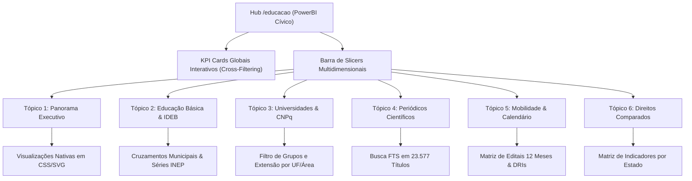

# Plano — /educacao: Hub Unificado de Educação, Pesquisa e Mobilidade Acadêmica (PowerBI Cívico)

> **Tipo:** PLANO DE UNIFICAÇÃO E PRODUTO  
> **Data:** 02/11/2026.  
> **Status:** Proposta detalhada, aguardando aprovação do dono.  
> **Worktree dedicada:** `.claude/worktrees/unifica-educacao` (Porta dev: `3049`, Branch: `unifica-educacao`).  
> **Escopo:** `apps/web/app/educacao/`, integração com `/universidades`, `/direitos-em-movimento/servicos?subfrente=educacao` e `/direitos-comparados`.

---

## 1. Diagnóstico Medido da Dispersão Atual

Hoje, o cidadão, estudante e pesquisador que acessa o portal em busca de dados de educação encontra a informação fragmentada em quatro ambientes sem conexão direta:

| Ambiente Atual | URL | Acervo e Dados Medidos | O que Falta / O que Causa Dispersão |
|---|---|---|---|
| **Serviços Essenciais (Educação Básica)** | `/direitos-em-movimento/servicos?subfrente=educacao` | 178.416 escolas, 47,3 mi de matrículas, série do IDEB (2015 a 2023) e cruzamentos municipais com repasses federais. | Isolado dentro de um seletor genérico de serviços (saúde, trabalho, educação), sem diálogo com o ensino superior ou pesquisa. |
| **Universidades & Extensão** | `/universidades` | 1.414 grupos de estudo e pesquisa CNPq, 170 projetos de extensão, 39 instituições de ensino superior, 11 unidades e 44 áreas temáticas. | Não se conecta com editais de intercâmbio, periódicos científicos nem com os indicadores da educação básica do mesmo estado. |
| **Direitos Comparados** | `/direitos-comparados` | Comparador de indicadores de direitos fundamentais e impacto das universidades no desenvolvimento social. | Página atua como sumário estático de cartões, apontando para `/universidades` e `/indicadores`. |
| **Periódicos & Intercâmbio** | `/periodicos` e `/educacao` | 23.577 periódicos científicos mundiais (6.759 contínuos e 16.818 cíclicos), 10 programas internacionais, 31 diretorias de RI globais e calendário de 12 meses. | Separado do acervo de grupos CNPq e da educação básica nacional. |

**Conclusão do Dono:** Está muito disperso. É necessário unificar as páginas em um só lugar, mantendo ferramentas e tópicos próprios com profundidade analítica, sem perda de dados, em formato interativo nativo estilo PowerBI.

---

## 2. Princípio da Solução: Hub Unificado com Ferramentas e Tópicos Próprios

Unificar **não significa achatar ou empobrecer os dados**. O princípio do projeto é:

1. **Central Canônica Única (`/educacao`):**
   - Todo o ecossistema educacional do portal passa a viver no hub `/educacao`.
   - Navegação por facetas e tópicos próprios com persistência de estado na URL (`/educacao?topico=basica`, `?topico=universidades`, `?topico=periodicos`, `?topico=intercambio`, `?topico=comparados`).
2. **Nenhuma Perda de Dados:**
   - 100% dos 1.414 grupos de pesquisa e 170 projetos de extensão permanecem pesquisáveis.
   - 100% dos 23.577 periódicos abertos e 14.729 títulos Diamante permanecem auditados.
   - 100% da série histórica do IDEB e indicadores do Censo Escolar permanecem integrados aos cruzamentos municipais.
3. **Não-Regressão e Preservação de URLs:**
   - `/universidades`, `/periodicos`, `/direitos-comparados` e `/direitos-em-movimento/servicos?subfrente=educacao` não quebram nem dão erro 404:
   - Ganham banners informativos e pontes canônicas redirecionando suavemente para o tópico correspondente do Hub Unificado.

---

## 3. Design Visual: PowerBI Cívico Nativo do Site

Seguindo as diretrizes de performance e soberania do repositório (sem bibliotecas externas pesadas como Chart.js ou PowerBI Embedded):



### Elementos Nativos Estilo PowerBI
1. **Cards KPI com Cross-Filtering:**
   - Clicar no cartão de "Educação Básica" filtra o dashboard imediatamente para o recorte escolar.
   - Clicar no cartão de "Universidades & CNPq" abre a visualização dos 1.414 grupos.
   - Clicar no cartão de "Periódicos Abertos" leva ao diretório de publicação com busca instantânea.
   - Clicar no cartão de "Intercâmbio & Mobilidade" filtra os editais mundiais e calendário.
2. **Slicers / Filtros Laterais e de Topo:**
   - **Nível Educacional:** Educação Básica (Infantil, Fundamental, Médio) | Ensino Superior (Graduação, Pós) | Pesquisa Científica & Extensão.
   - **Âmbito Geográfico:** Brasil (Nacional, Estados, Municípios) | Lusófonos | América Latina | Global (141 países).
   - **Gratuidade / Financiamento:** 100% Gratuito (Sem APC / Bolsas Integrais) | Com Custo / Mensalidade.
3. **Gráficos e Matrizes Visuais em CSS/SVG Puro:**
   - Gráfico de barras da evolução do IDEB (2015-2023) comparado à meta nacional.
   - Gráfico proporcional de barras com distribuição de periódicos gratuitos (Diamante) vs comerciais.
   - Matriz de bolsas e editais ativos por mês do ano (Janeiro a Dezembro).
   - Matriz comparativa de indicadores entre estados e regiões.

---

## 4. Estrutura dos 6 Tópicos Próprios no Hub Unificado

### Tópico 1: 📊 Panorama Executivo (Dashboard PowerBI)
- Cartões consolidados de topo calculados matematicamente:
  - 178.416 escolas | 47,3 mi de matrículas | IDEB 5,8 (meta 6,0).
  - 39 universidades | 1.414 grupos CNPq | 170 projetos de extensão.
  - 23.577 periódicos mundiais (62,5% Diamante sem taxas).
  - 10 programas internacionais de intercâmbio | 31 diretorias de RI globais.
- Gráficos integrados de distribuição por área do conhecimento e alcance geográfico.

### Tópico 2: 🏫 Educação Básica, Censo Escolar & IDEB Municipal
- Mantém integralmente o acervo de `/direitos-em-movimento/servicos?subfrente=educacao`.
- Série histórica do IDEB (2015, 2017, 2019, 2021, 2023) com notas metodológicas.
- Ferramenta de cruzamento municipal (`calcularCruzamentosMunicipais`): relação entre repasses federais per capita e nota do IDEB.
- Indicadores de infraestrutura: internet banda larga (88,2%), saneamento e laboratórios.

### Tópico 3: 🔬 Universidades: Grupos CNPq & Extensão Comunitária
- Incorpora os dados de `/universidades` sem qualquer perda:
  - Tabela filtrável com os 1.414 grupos de estudo e 170 projetos de extensão.
  - Filtros por: Grande Área, Instituição (UFMG, USP, UFRJ, UEMG, etc.), Estado e Linha de Pesquisa.
  - Contatos institucionais de líderes e links para o Diretório dos Grupos de Pesquisa do CNPq.
  - Subpáginas por instituição (`/universidades/[sigla]`) preservadas e linkadas.

### Tópico 4: 📚 Periódicos Científicos & Publicação Aberta Mundial
- Incorpora o acervo de `/periodicos`:
  - 23.577 títulos auditados do DOAJ e SciELO.
  - Filtros instantâneos por: Fluxo Contínuo vs Chamadas Cíclicas (semestrais, anuais, trimestrais).
  - Filtro Acesso Aberto Diamante (14.729 títulos 100% gratuitos).
  - Tempo médio de avaliação em semanas, licenças Creative Commons e registros DOI/ISSN.

### Tópico 5: ✈️ Mobilidade Acadêmica, Intercâmbio & Calendário Anual
- Incorpora os módulos de mobilidade internacional:
  - 10 programas de intercâmbio com editais e benefícios (Erasmus+, PILA, AUGM/Escala, Brafitec, Santander, Fulbright, DAAD...).
  - Diretório de 31 Diretorias de Relações Internacionais (DRI/SRI/IRO) no Brasil, Europa, América Latina, América do Norte, Ásia/China, África e Oceania.
  - Calendário mês a mês (Janeiro a Dezembro) com prazos de submissão e editais de bolsas.
  - Cursos e canais de contato de professores coordenadores.

### Tópico 6: ⚖️ Direitos Comparados & Marcos Legais da Educação
- Incorpora o recorte de educação de `/direitos-comparados`:
  - Comparativo dos índices educacionais entre as 27 Unidades da Federação.
  - Marcos normativos: Constituição Federal (art. 205 a 214), LDB (Lei 9.394/1996), Fundeb permanente (EC 108/2020) e PNE.
  - Tratados internacionais: Declaração Universal dos Direitos Humanos (art. 26), Pacto de San José e Convenções da UNESCO.

---

## 5. Arquitetura de Código e Componentização

```
apps/web/app/educacao/
├── page.tsx                             # Hub unificado com renderização SSR/SSG
├── PainelEducacaoPowerBI.tsx            # Componente central interativo do Dashboard
├── componentes/
│   ├── KpisExecutivos.tsx               # Cartões superiores com cross-filtering
│   ├── SlicersBar.tsx                   # Filtros multidimensionais tipo PowerBI
│   ├── TopicoBasicaIdeb.tsx             # Educação básica, IDEB e cruzamentos
│   ├── TopicoUniversidadesExtensao.tsx  # Grupos CNPq e projetos de extensão
│   ├── TopicoPeriodicosCientificos.tsx  # Busca e filtros dos 23.577 periódicos
│   ├── TopicoIntercambioCalendario.tsx  # Mobilidade, DRIs e calendário 12 meses
│   └── TopicoDireitosComparados.tsx     # Comparador de indicadores e marcos legais
```

---

## 6. Ambiente e Worktree de Desenvolvimento

Conforme regra dura do repositório (AGENTS §5.4 e DESENVOLVIMENTO):
- **Worktree:** `.claude/worktrees/unifica-educacao` (Branch `unifica-educacao`).
- **Junctions criadas:** `node_modules` e `apps/web/node_modules` apontando para o canônico.
- **Porta dedicada:** `3049`, registrada e validada em `.claude/launch.json` sem conflitos de portas.
- **Commits:** Na branch `unifica-educacao`, com pathspec explícito e mensagem via `-F`.

---

## 7. Critérios de Aceite e Verificação

1. **Unificação Real:** Todas as 4 frentes acessíveis pelo Hub `/educacao` através de abas ou query params (`?topico=...`).
2. **Zero Regressão de Dados:**
   - 178.416 escolas e histórico do IDEB preservados.
   - 1.414 grupos CNPq e 170 projetos de extensão com busca ativa.
   - 23.577 periódicos com busca FTS e filtros de periodicidade.
   - 31 diretorias mundiais e calendário de 12 meses preservados.
3. **Estilo PowerBI Cívico:** Cartões interativos que atuam como filtros, gráficos em CSS/SVG nativo e visual executivo fluido.
4. **Exportabilidade:** Botão único de exportação em CSV com BOM UTF-8 e `;` respeitando os dados do tópico ativo.
5. **Acessibilidade e Responsividade:**
   - Testado em 390 px para telas de smartphones sem rolagem horizontal falsa.
   - Nenhuma tipografia menor que 12 px (`text-[9|10|11px]` barrados pela Regra 5.16).
6. **Segurança e Privacidade:**
   - Validação com `vitest run lib/sem-cpf-no-repo.test.ts` e `python scripts/checar-dado-pessoal.py`.
